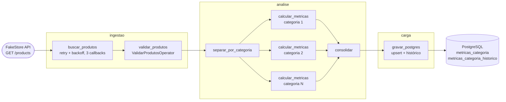

# Decisões de projeto

Como a DAG `ecommerce_metricas` foi construída e por quê. Foi feita em camadas: cada uma entra,
é testada isoladamente e só então a próxima começa. Para cada camada: o que entrou, por quê,
como foi provado e o que se observou.

## Objetivo

Todo dia às 06:00 (Brasília), buscar os produtos da [FakeStore API](https://fakestoreapi.com),
calcular por categoria preço médio, mínimo, máximo e quantidade, e gravar no Postgres sem duplicar.



Desenho final. O plano inicial não tinha `validar_produtos` (entrou como opcional) nem o histórico;
as seções abaixo contam a ordem em que cada parte entrou.

## A fonte de dados

- **Uma chamada só, `GET /products`.** As categorias saem dos próprios produtos. Chamar também
  `/products/categories` seria uma segunda requisição que pode falhar ou divergir da primeira.
- **Cuidados com o dado:** `price` vem como int ou float (normalizado com `float`);
  `men's clothing` tem apóstrofo, então o SQL usa só parâmetros, nunca concatenação; `jewelery`
  é grafado assim na fonte e não é corrigido; um 404 não vira exceção em `requests` sem
  `raise_for_status()`.

## Qual data gravar

`data_coleta` = `data_interval_end` no fuso de Brasília, não o `ds`.

O `ds` é o *início* do intervalo agendado: a execução que roda em 16/11 às 06:00 tem `ds` = 15/11.
A API devolve o retrato do momento da coleta, então a data certa é o fim do intervalo. Na execução
agendada, o fim do intervalo é o próprio 06:00 em que ela roda.

Em execução manual (trigger na UI, `airflow dags test <data>`), o Airflow **recua o fim do
intervalo para o último 06:00 antes do disparo**, e o `ds` fica igual à data do disparo. Um disparo
às 11:00 de 22/11 grava 22/11; um disparo às 05:30 de 23/11 também cairia em 22/11. Visto na
tabela `dag_run`: as execuções manuais das 11h têm `data_interval_end = 2026-11-22 09:00 UTC`.
Uma primeira versão deste doc dizia que o fim era o momento do disparo; o code review da fase 6
mostrou o erro.

Isso cria um risco: a API só devolve o catálogo de agora, então uma execução de outro dia (disparo
antes das 06:00, Clear de uma execução antiga) gravaria os preços de hoje como se fossem daquele
dia, por cima do histórico verdadeiro. Por isso `buscar_produtos` recusa execução cuja data não é a
de hoje (ver "Fase 6"). Re-executar no mesmo dia repete a data e sobrescreve as mesmas linhas, o
que sustenta a idempotência.

## Ambiente

- Airflow 2.9.3 (LocalExecutor) e **dois Postgres**: um de metadados do Airflow e outro só para os
  dados (`postgres-ecommerce`). Dado de negócio não se mistura com o controle interno da ferramenta.
- O serviço `airflow-init` cria a Connection `postgres_ecommerce` e o pool `ecommerce_pool`
  (2 slots). Quem clona o repo sobe tudo sem configurar nada pela UI, e credencial não fica no
  código da DAG.

- `AIRFLOW__CORE__FERNET_KEY` fica vazio de propósito: a senha da Connection e as Variables
  ficam em texto puro no banco de metadados. Para um ambiente local com credencial descartável,
  isso é aceitável, e quem clona sobe tudo sem gerar chave. Num ambiente compartilhado, a chave
  iria num `.env` fora do git, com um `.env.example` no repo.
- Efeito colateral visto nos logs: o Airflow mascara a senha das Connections em todo log, e a
  senha era `ecommerce`. Por isso a palavra aparecia como `***` até no nome da DAG
  (`dag_id=***_metricas`), e `airflow` (senha do banco de metadados) vira `***` na linha de comando
  da task. O mascaramento funciona; o problema era a senha ser uma palavra do código. Depois do
  alerta simulado, em que isso quebrou o link do log, a senha virou `ecommerce_dev_2026` (ver
  "Alerta simulado em todas as tasks").

### Problemas encontrados ao subir

Os três vieram da mesma escolha: rodar o Airflow com o UID do usuário (`user: ${AIRFLOW_UID}`), para
os logs em `./logs` saírem com o dono certo sem `chmod`.

1. **`Unable to configure handler 'processor'`.** Se `./logs` não existe, o Docker cria a pasta do
   bind mount como root, e o Airflow, rodando sem ser root, não consegue escrever nela. Primeira
   correção: criar a pasta antes da primeira subida (`mkdir -p logs`). Isso exigia um passo manual
   de quem clona, então na fase 8 o `airflow-init` passou a rodar como root (`user: "0:0"`) e a
   fazer `chown` de `./logs` para o `AIRFLOW_UID`, no começo e no fim do script: mesmo esquema do
   compose oficial do Airflow. O lab da disciplina resolve com `mkdir -p logs && chmod -R 777
   logs`; aqui, nenhum passo antes do `up`.
2. **`getpwuid(): uid not found: 1000`.** O init usava `entrypoint: /bin/bash`, o que pula o
   entrypoint da imagem, que é quem registra o UID arbitrário no `/etc/passwd`. Correção: manter o
   entrypoint padrão e passar o script em `command: [bash, -c, ...]`.
3. **Sucesso falso no init.** Sem `set -e`, o script do init terminava com código 0 mesmo com o
   `airflow db migrate` quebrado, porque o último comando era um `echo`. O erro só aparecia depois,
   no scheduler (`You need to initialize the database`). Correção: `set -e` no início do script.
   Lição geral: "ok" impresso no fim de um script não prova nada se um passo do meio pode falhar
   em silêncio.

## Camadas

### 5.1 Esqueleto da DAG

- **O quê:** `@dag` com `schedule="0 6 * * *"`, `start_date` em `America/Sao_Paulo` (`zoneinfo`),
  `catchup=False`, e uma task provisória que imprime `ds`, `data_interval_start` e
  `data_interval_end`.
- **Por quê:** sem o fuso, o cron roda em UTC (06:00 UTC = 03:00 em Brasília). Sem
  `catchup=False`, o Airflow tentaria executar todos os dias desde o `start_date`.
  O fuso usa `zoneinfo`, da biblioteca padrão, em vez do `pendulum` que o enunciado cita. A
  troca é consciente: o `zoneinfo` foi comentado em aula como alternativa nativa.
  Testado no 2.9.3: o Airflow converte para pendulum por dentro, serializa a DAG e calcula a
  próxima execução às 06:00 de Brasília. O `pytz` foi descartado:
  `datetime(..., tzinfo=pytz.timezone(...))` pega o fuso histórico de 1914 (-03:06) em silêncio.
- **Teste:** `airflow tasks test ecommerce_metricas mostrar_datas <data>`.
- **Observado:** o comportamento de `ds` x `data_interval_end` descrito em "Qual data gravar".

### 5.2 Task `buscar_produtos`

- **O quê:** substitui a task provisória. Faz `GET /products` com `timeout=30`, chama
  `raise_for_status()` e devolve uma lista com só `{id, category, price}`, com `price` em `float`.
- **Por quê:** sem timeout, uma API travada prende o worker indefinidamente. Sem
  `raise_for_status()`, um 404/500 passaria como sucesso. O retorno vira XCom, guardado no banco
  de metadados, então leva só os 3 campos que o pipeline usa (sem título, descrição e imagem).
- **Teste:**
  ```bash
  docker compose exec airflow-scheduler airflow tasks test ecommerce_metricas buscar_produtos 2026-11-17
  ```
- **Observado:** `20 produtos recebidos`, `Marking task as SUCCESS`. Retorno com 4 categorias:
  `men's clothing` (4), `jewelery` (4), `electronics` (6), `women's clothing` (6); preços inteiros
  já convertidos (ex.: `695.0`).

### 5.3 Resiliência em `buscar_produtos`

- **O quê:** `retries=3` com `retry_delay=10s`, `retry_exponential_backoff=True` e
  `max_retry_delay=5min`; callbacks de sucesso, retry e falha. Os erros se dividem em dois tipos:
  - **temporário** (rede, DNS, timeout, HTTP 5xx e 429): loga e relança, e o retry cuida;
  - **permanente** (outro 4xx, JSON inválido, campo faltando, preço inválido, lista vazia):
    `AirflowFailException`, que falha na hora sem gastar os retries.

  Rede/HTTP e formato da resposta ficam em dois blocos `try`. A URL vem da Variable
  `fakestore_url`, com a URL real como padrão. Preço passa por `_preco()`, que rejeita `NaN`,
  infinito, negativo e booleano.
- **Por quê:**
  - Um `except` sem `raise` engoliria o erro, e a task terminaria verde sem dado.
  - O backoff dá tempo para a API voltar sem martelá-la. Já um 404 ou um campo renomeado não
    melhoram esperando: retentar só atrasa o alerta em ~2 min e faz o callback de retry tratar
    como passageiro um erro que não é.
  - Os dois blocos existem porque `resposta.json()` levanta `JSONDecodeError`, que é ao mesmo tempo
    `RequestException` e `ValueError`. Num bloco só, um corpo que não é JSON seria logado como
    falha de rede.
  - `float()` aceita `"NaN"`, `"inf"`, `True` e negativos, e qualquer um estragaria as métricas
    sem erro nenhum. Lista vazia gravaria um "dia sem produtos" como se fosse verdade.
  - A Variable permite forçar cada tipo de falha no teste sem editar o código.
- **Teste:** pela UI, não com `airflow tasks test`, que executa uma tentativa só e não exercita o
  retry.
  ```bash
  # permanente: 404
  docker compose exec airflow-scheduler airflow variables set fakestore_url https://fakestoreapi.com/produtosx
  # temporário: host que não existe (.invalid é reservado e nunca resolve)
  docker compose exec airflow-scheduler airflow variables set fakestore_url https://fakestoreapi.invalid/products
  # depois dos testes, senão a execução agendada falha:
  docker compose exec airflow-scheduler airflow variables delete fakestore_url
  ```
  A validação de preço foi testada chamando `_preco()` direto no container: `10`, `22.3` e `"5"`
  passam; `"NaN"`, `"inf"`, `-1` e `True` são rejeitados.
- **Observado:**
  - Sucesso: `[callback sucesso] buscar_produtos terminou bem na tentativa 1`.
  - Permanente: só `attempt=1.log`, `Erro permanente HTTP 404`,
    `Immediate failure requested. Marking task as FAILED` e
    `[callback falha] ... falhou de vez na tentativa 1`, sem nenhum retry.
  - Temporário: `attempt=1.log` a `attempt=4.log`, `NameResolutionError` em cada uma,
    `[callback retry]` nas tentativas 1, 2 e 3 e `[callback falha] ... na tentativa 4`. Espera
    entre o fim de uma tentativa e o início da seguinte: ~17 s, ~23 s e ~59 s. Uma rodada
    anterior deu ~18, ~25 e ~80 s. As duas caem nas faixas de 10-20, 20-40 e 40-80 s, somadas ao
    ciclo do scheduler. O Airflow escolhe o ponto dentro da faixa por um hash de dag, task, data e
    tentativa: tasks diferentes se espalham, mas a mesma execução e tentativa sempre esperam o
    mesmo tempo.
  - **Armadilha do `try_number` antes do Airflow 2.10.** O primeiro teste de sucesso logou
    "terminou bem na tentativa 2" numa execução que acertou de primeira: havia só
    `attempt=1.log`, nenhum retry no log, e `try_number = 1` na tabela `task_instance` do banco de
    metadados. Nessas versões, `ti.try_number` vale a tentativa atual só enquanto a task roda;
    terminada (sucesso, falha ou retry), passa a valer a próxima. Callbacks rodam depois do fim,
    então `_tentativa()` desconta 1, mas só se a versão for anterior à 2.10, que corrigiu isso.
  - Logs completos dos três testes (cópia de `logs/`, que fica fora do git) em
    [`evidencias/5.3/`](evidencias/5.3/): `1-sucesso.log`, `2-permanente-404.log` e
    `3-temporario-dns-tentativa-1.log` a `-4.log`.
  - Callbacks normalmente logam no log da task. Se o processo da task morre (falta de memória,
    heartbeat perdido), o Airflow roda o de falha no DagFileProcessor, e a mensagem vai para o
    log dele.

### 5.4 Fan-out por categoria, no pool

- **O quê:** `separar_por_categoria` agrupa os preços e devolve uma lista de pares
  `{categoria, precos}`, em ordem alfabética. `calcular_metricas.expand(par=...)` cria uma
  instância por par, com `pool="ecommerce_pool"` (2 slots), e cada uma devolve `qtd`, `media`
  (2 casas), `minimo` e `maximo`. O `map_index_template` faz a UI mostrar o nome da categoria em
  vez de `0..3`. A Variable `atraso_metricas_s` (padrão 0) faz cada instância dormir N segundos
  antes de calcular.
- **Por quê:**
  - Os pares já levam os preços, então nenhuma instância chama a API de novo: uma requisição só
    por execução, e as tasks mapeadas não dependem da rede.
  - O número de categorias vem do dado, não do código. Se a API ganhar uma quinta categoria, o
    `.expand` cria a quinta instância sozinho.
  - O pool limita quantas instâncias rodam ao mesmo tempo, qualquer que seja o número de
    categorias. É o recurso para proteger um banco ou uma API de excesso de conexões.
  - O cálculo leva milissegundos, então a fila do pool mal aparece. O atraso deixa as duas levas
    visíveis na UI. Segue o padrão do `fakestore_url`: o código entregue não espera nada, e o
    teste se repete com um comando, sem editar o código.
- **Teste:** pela UI.
  1. Disparar sem Variable e abrir `calcular_metricas` → **Mapped Tasks**.
  2. Pool:
     ```bash
     docker compose exec airflow-scheduler airflow variables set atraso_metricas_s 15
     # disparar e abrir Admin → Pools ou Browse → Task Instances; depois:
     docker compose exec airflow-scheduler airflow variables delete atraso_metricas_s
     ```
- **Observado:**
  - 4 instâncias, cada uma com o nome da sua categoria. Conferido à mão em `men's clothing`
    (109.95, 22.3, 55.99, 15.99): `qtd 4, media 51.06, minimo 15.99, maximo 109.95`.
  - Com atraso de 15 s: `electronics` e `jewelery` começam às 10:53:28 e terminam às 10:53:44;
    `men's clothing` e `women's clothing` ficam em `scheduled` até lá e começam às 10:53:44.9.
    Duas levas de 2, nunca mais de 2 ao mesmo tempo.
  - O limite já aparecia sem atraso: na primeira execução, a segunda dupla começou às 10:48:32,
    só depois de a primeira terminar (10:48:31). Com atraso, a diferença fica grande o bastante
    para ver na tela.
  - Evidências em [`evidencias/5.4/`](evidencias/5.4/): logs de `separar_por_categoria` e das 4
    instâncias, print das Mapped Tasks, print de Task Instances com 2 `running` e 2 `scheduled`,
    e os horários tirados da tabela `task_instance` (`5-task_instance-horarios.txt`, com
    `rendered_map_index` e `pool` gravados).

### 5.5 Fan-in: `consolidar`

- **O quê:** `consolidar(metricas)` recebe a saída das instâncias mapeadas de
  `calcular_metricas` numa lista. Acrescenta `data_coleta` (o `data_interval_end` convertido para
  Brasília, em texto ISO), ordena por categoria e devolve as linhas prontas para a gravação.
- **Por quê:**
  - É o ponto de encontro do fan-out: o Airflow só roda a task depois que todas as instâncias
    terminam. A gravação recebe um lote único e consistente, em vez de uma escrita por categoria.
  - `data_interval_end` chega pelo nome do parâmetro (o TaskFlow injeta variáveis do contexto).
    A conversão para Brasília vem antes de tirar a data, porque em UTC uma execução depois das
    21:00 cairia no dia seguinte. Fica em texto porque o XCom é JSON.
- **Topologias, de forma identificável:**
  - linear: `buscar_produtos` → `separar_por_categoria`;
  - fan-out: `separar_por_categoria` → `calcular_metricas` ×N, em paralelo, limitado pelo pool;
  - fan-in: `calcular_metricas` ×N → `consolidar`.

  Na Graph, a task mapeada aparece como um nó só, `calcular_metricas [ ]`, porque as instâncias
  só existem em tempo de execução: dependem de quantas categorias a API devolve. Com uma execução
  selecionada, o nó mostra a contagem. As instâncias aparecem em **Mapped Tasks** ou no Gantt.
- **Teste:** disparar pela UI e ler o log de `consolidar`.
- **Observado:** `4 linhas para 2026-11-22` (trigger manual às 11:02: o fim do intervalo recua para
  o 06:00 do mesmo dia), com as mesmas métricas da 5.4. Evidências em
  [`evidencias/5.5/`](evidencias/5.5/): log de `consolidar` e print da Graph.

### 5.6 Gravação idempotente: `gravar_postgres`

- **O quê:** `PostgresHook(postgres_conn_id="postgres_ecommerce")` e uma transação só com três
  passos: `CREATE TABLE IF NOT EXISTS metricas_categoria` (chave primária
  `(data_coleta, categoria)`, preços em `NUMERIC(10,2)`); upsert com
  `INSERT ... ON CONFLICT (data_coleta, categoria) DO UPDATE`; e `DELETE` das categorias do dia que
  não vieram no lote. A coluna `atualizado_em` recebe `now()` a cada gravação.
- **Por quê:**
  - Chave primária + `ON CONFLICT`: re-rodar o mesmo dia sobrescreve em vez de duplicar. É o
    problema do enunciado ("quando alguém roda na mão, os números aparecem duplicados").
  - Valores sempre por parâmetro (`%(categoria)s`), nunca concatenados: `men's clothing` tem
    apóstrofo, e concatenar quebraria o SQL ou abriria espaço para injeção.
  - `DELETE` das sumidas: sem ele, se uma categoria some da API e o dia é reprocessado, a linha
    antiga fica para trás, e o dia gravado deixa de ser o retrato da última coleta.
  - Uma transação: ou o dia inteiro muda, ou nada muda. Uma falha no meio não deixa metade das
    categorias novas e metade antigas.
  - `NUMERIC` e não `float`: o banco guarda os centavos exatos.
  - `atualizado_em` prova, olhando a tabela, que a linha foi sobrescrita, não inserida de novo.
  - Credencial na Connection (criada pelo `airflow-init`), não no código.
- **Teste:**
  ```bash
  docker compose exec postgres-ecommerce psql -U ecommerce -d ecommerce -c "SELECT * FROM metricas_categoria ORDER BY categoria;"
  ```
  1. Disparar a DAG e consultar a tabela.
  2. **Clear** em `gravar_postgres` da mesma execução (mesmo XCom) e consultar de novo.
  3. Disparar outra execução no mesmo dia (mesma `data_coleta`) e consultar.
  4. Categoria sumida: inserir uma linha falsa no dia e dar Clear em `gravar_postgres`.
     ```bash
     docker compose exec postgres-ecommerce psql -U ecommerce -d ecommerce -c "INSERT INTO metricas_categoria VALUES ('2026-11-22', 'categoria-fantasma', 1, 1, 1, 1);"
     ```
- **Observado:** o dia ficou com 4 linhas depois de cada uma das gravações (11:16:39, Clear às
  11:17:13, outra execução às 11:18:47), com `atualizado_em` avançando a cada uma. No teste 4, o
  log disse `1 categorias sumidas removidas; o dia tem 4 linhas na tabela`, e a fantasma saiu.
  Evidências em [`evidencias/5.6/`](evidencias/5.6/): os logs de cada gravação e a tabela
  consultada antes e depois do teste 4.

### 5.7 TaskGroups: `ingestao`, `analise`, `carga`

- **O quê:** três funções com `@task_group` envolvem as chamadas das tasks, e a DAG termina em
  `carga(analise(ingestao()))`. `ingestao` tem `buscar_produtos`; `analise` tem
  `separar_por_categoria`, `calcular_metricas` (mapeada) e `consolidar`; `carga` tem
  `gravar_postgres`.
- **Por quê:**
  - O enunciado pede pelo menos 2 grupos. O terceiro, `carga`, separa o "L" do ETL: quem abre a
    Graph lê extrair → transformar → carregar sem abrir o código.
  - `analise` concentra as três topologias (linear, fan-out, fan-in), que ficam visíveis ao
    abrir o grupo.
  - É só organização: as tasks e as dependências não mudam. As dependências continuam saindo
    das chamadas das funções.
- **Efeito colateral:** o id de cada task ganha o prefixo do grupo (`ingestao.buscar_produtos`,
  `carga.gravar_postgres`). Os comandos de teste das camadas anteriores passam a usar o id novo
  (ex.: `airflow tasks test ecommerce_metricas ingestao.buscar_produtos <data>`), e os logs ficam
  em `task_id=ingestao.buscar_produtos/`. O mesmo vale para o nome que os callbacks logam.
- **Teste:** disparar pela UI e abrir a Graph.
- **Observado:** execução completa em `success`, com as 5 tasks com prefixo (4 instâncias de
  `analise.calcular_metricas`). Na Graph, os 3 grupos aparecem em sequência. Evidências em
  [`evidencias/5.7/`](evidencias/5.7/): print da Graph com os grupos abertos e os estados das
  tasks tirados do banco de metadados.

## Fase 6: conferência dos requisitos e code review

Com as camadas prontas, o código passou por um code review completo e pela conferência item a item
do enunciado. Entraram:

- **Proteção da data da execução.** `buscar_produtos` compara a data da execução
  (`data_interval_end` em Brasília) com hoje. Se forem diferentes, levanta `AirflowFailException`
  antes de chamar a API: sem retry, com `[callback falha]`. Motivo em "Qual data gravar". A regra
  da data virou uma função só, `_data_coleta()`, usada também por `consolidar`.
  Alternativas descartadas: gravar a data real da coleta (re-rodar uma execução antiga criaria o
  dia de hoje, e "re-rodar a mesma run" deixaria de cair na mesma linha) e só documentar o risco.
- **Categoria validada** (`_categoria()`): nula ou vazia quebraria `separar_por_categoria`, que
  não tem retry nem callback, e o alerta não dispararia. Agora é erro de formato na
  `buscar_produtos`.
- **Teto do preço** em 99.999.999,99, o limite de `NUMERIC(10,2)`: acima disso, o erro só
  apareceria na gravação.
- **HTTP 408 e 425** contam como temporários, junto de 429 e 5xx.
- **`gravar_postgres` com `retries=2`** (30 s): a gravação é idempotente, então retentar é seguro,
  e uma queda rápida do banco às 06:00 não perde o dia.
- **`max_active_runs=1`**: uma execução manual não grava junto com a agendada.
- **`atraso_metricas_s` tolerante:** valor inválido vira 0 com aviso, em vez de derrubar as
  instâncias.
- **Tentativa mínima 1 nos callbacks:** `airflow dags test` não conta tentativas (`try_number` fica
  0), e o log dizia "tentativa 0".

Teste da proteção:
```bash
docker compose exec airflow-scheduler airflow dags test ecommerce_metricas 2026-11-20
```
`2026-11-20` é meia-noite UTC (21:00 de 19/11 em Brasília), e o último 06:00 antes disso é o de
19/11. Observado: `execução do dia 2026-11-19, mas hoje é 2026-11-22`,
`Immediate failure requested`, `[callback falha]`, as 4 tasks seguintes em `upstream_failed`, e a
tabela sem nenhuma linha de 19/11. Uma execução normal pela UI, logo antes, seguiu em `success`.
Evidências em [`evidencias/fase6/`](evidencias/fase6/).

## Estrutura do código

Depois da fase 6, a DAG saiu de um arquivo só (~330 linhas misturando callbacks, validação, SQL,
chamada da API e montagem) para um arquivo de DAG fino e um pacote com a lógica:

```
dags/
  ecommerce_metricas.py   só a DAG: tasks finas, TaskGroups e a ligação
  .airflowignore          o scheduler não varre ecommerce/ procurando DAG
  ecommerce/
    api.py         busca na FakeStore; erro temporário sobe, permanente vira ErroPermanente
    validacao.py   preco(), categoria(), PRECO_MAXIMO
    operadores.py  ValidarProdutosOperator (entrou depois, ver o opcional)
    calculo.py     separar_por_categoria(), calcular_metricas(), consolidar(): puras
    banco.py       SQL e gravar_metricas(conn, linhas)
    callbacks.py   os 3 callbacks e tentativa()
    datas.py       TZ, data_coleta(), hoje()
```

- **Por quê:** o scheduler re-parseia o arquivo da DAG a cada ~30 s, e quem abre o arquivo quer
  ver o fluxo, não os detalhes. O Módulo 02 da disciplina diz: "se sua DAG é grande demais para
  ler em 5 minutos, é hora de modularizar". Além disso, lógica em função comum se testa sem subir
  o Airflow.
- **Fronteira:** o que é do Airflow fica na DAG: Variables, contexto, pool e
  `AirflowFailException`. A `api.py` levanta uma exceção própria, `ErroPermanente`, e a DAG a
  traduz para `AirflowFailException`; o erro temporário sobe como veio, para o retry. Assim a
  regra "temporário x permanente" fica num módulo testável sem Airflow. As exceções são
  `callbacks.py` (lê a versão do Airflow) e `banco.py`, que recebe a conexão já aberta pelo
  `PostgresHook`.
- **Import:** `dags/` já está no `sys.path` do Airflow, então `from ecommerce import api` funciona
  sem mexer no compose.
- **O que mudou no comportamento:** nada. As evidências das camadas anteriores citam linha e
  arquivo da versão de arquivo único e continuam valendo como registro de cada camada.
- **Teste de fumaça** depois da mudança: execução normal em `success` (callback de sucesso agora
  logado por `callbacks.py`, gravação com 4 linhas no dia) e erro permanente com a URL de 404
  (`api.py` loga `Erro permanente HTTP 404`, a DAG falha na hora, `[callback falha] ... na
  tentativa 1`). O `dags test` da proteção da data também passou e agora loga "tentativa 1" (antes,
  "tentativa 0"). Evidências em [`evidencias/estrutura/`](evidencias/estrutura/).

## Opcional: tabela de histórico

- **O quê:** `metricas_categoria_historico`, só com `INSERT`: `id` serial, `executado_em`
  (`now()`), `run_id`, `data_coleta` e as 4 métricas. Gravada por `banco.gravar_metricas` na mesma
  transação do snapshot. O `run_id` chega do contexto pelo nome do parâmetro em `gravar_postgres`.
- **Por quê:**
  - O snapshot responde "qual é o número do dia": uma linha por categoria por dia, sobrescrita a
    cada reprocessamento. O histórico responde "o que foi gravado e quando" e cresce a cada
    gravação, inclusive dentro do mesmo dia. É ele que permite acompanhar a evolução dos preços.
  - Mesma transação: nunca existe histórico de uma gravação que o snapshot não recebeu, nem o
    contrário.
  - `run_id` liga cada linha à execução do Airflow que a gravou, para rastrear de onde veio um
    número.
- **Teste:** disparar a DAG mais de uma vez no mesmo dia e comparar as tabelas.
  ```bash
  docker compose exec postgres-ecommerce psql -U ecommerce -d ecommerce -c "SELECT data_coleta, count(*) AS snapshot FROM metricas_categoria GROUP BY 1;" -c "SELECT run_id, count(*) AS historico, min(executado_em) FROM metricas_categoria_historico GROUP BY 1 ORDER BY 3;"
  ```
- **Observado:** três execuções; o snapshot ficou em 4 linhas, o histórico com 3 `run_id` de 4
  linhas cada (12). De quebra, apareceu o `max_active_runs=1` em ação: a segunda execução foi
  disparada 3 s depois da primeira, ficou enfileirada e só começou às 12:07:22, quando a primeira
  terminou. Evidências em [`evidencias/opcional-historico/`](evidencias/opcional-historico/).

## Fase 8: entrega

- `README.md` com como rodar, a tabela "requisito → onde está → evidência", os opcionais e como
  testar cada comportamento.
- **Teste do clone limpo:** o repositório clonado do GitHub numa pasta nova, sem `.env` e sem
  criar `logs/`, subiu só com `docker compose up -d`. O `airflow-init` criou `logs/` com dono 50000
  (o padrão sem `.env`), os 4 serviços ficaram `healthy`, e a execução disparada ao despausar
  terminou em `success`, com 4 linhas no snapshot e 4 no histórico.
- **Armadilha do teste:** o Compose nomeia o projeto pela pasta. Um clone noutra pasta também
  chamada `atividade-01` reaproveitaria os containers e volumes da pilha de desenvolvimento. Por
  isso o teste usou `docker compose -p clone-teste ...`, e a pilha original foi parada antes
  (mesmas portas 8080 e 5434).
- **Repetido na versão final** (depois do operador, dos testes, do alerta e da senha nova): o
  clone subiu, a DAG de 6 tasks rodou de ponta a ponta com 4 linhas no snapshot e 4 no histórico,
  e `docker compose run --rm testes` deu 62 passed.
- **Armadilha nova no segundo clone:** o primeiro `up` foi dado com a pilha original ainda no ar.
  A porta 5434 estava ocupada, o Docker falhou ao configurar a rede do `postgres-ecommerce` do
  clone, e o container ficou criado **sem rede nenhuma**. O `up` seguinte, já com as portas
  livres, só iniciou o container como estava, e a `gravar_postgres` falhou com
  `could not translate host name "postgres-ecommerce"` (o alerta disparou, já sem `***`). Correção:
  `docker compose -p clone-teste up -d --force-recreate postgres-ecommerce`. Lição: depois de um
  `up` que falhou no meio, conferir `docker inspect` (redes e portas) ou recriar, em vez de
  confiar que o próximo `up` conserta.
- Evidências em [`evidencias/fase8-clone-limpo/`](evidencias/fase8-clone-limpo/).

## Opcional: `ValidarProdutosOperator`

- **O quê:** operador customizado em `dags/ecommerce/operadores.py`, subclasse de `BaseOperator`,
  entre `buscar_produtos` e `separar_por_categoria`, no grupo `ingestao`. Recebe a lista bruta e
  devolve a lista validada. Confere: lista não vazia, cada item é objeto, `id` inteiro e sem
  repetição, categoria e preço pelas regras de `validacao.py`. Junta todos os erros antes de
  falhar com `AirflowFailException`, listando os 5 primeiros. Tem `on_failure_callback`.
  `buscar_produtos` passou a só extrair os 3 campos e conferir o formato geral (JSON, lista, não
  vazia); a validação campo a campo saiu da `api.py` e foi para o operador.
- **Por quê:**
  - Operador é a forma de empacotar lógica reutilizável em várias DAGs: qualquer DAG que receba
    produtos pode validá-los sem copiar código. As regras de cada campo continuam num lugar só
    (`validacao.py`); o operador aplica as regras à lista e decide se a execução segue.
  - Todos os erros de uma vez: quem investiga vê quantos produtos vieram ruins e por quê, em vez
    de corrigir um e descobrir o próximo na execução seguinte.
  - `AirflowFailException`: dado inválido não melhora com retry. O callback de falha garante o
    alerta também nesse caso.
  - `template_fields = ("produtos",)` é o que faz o Airflow trocar o XComArg pela lista real
    antes do `execute`. É o que permite misturar um operador clássico com tasks TaskFlow: a
    dependência sai da passagem do XComArg (`produtos=buscar_produtos()`), sem `>>`.
- **Teste:**
  1. Execução normal pela UI.
  2. Schema inválido: o endpoint `/users` da própria FakeStore devolve uma lista válida de objetos
     que não têm `category` nem `price`.
     ```bash
     docker compose exec airflow-scheduler airflow variables set fakestore_url https://fakestoreapi.com/users
     # disparar; depois:
     docker compose exec airflow-scheduler airflow variables delete fakestore_url
     ```
  O operador também foi testado isolado no container, com uma lista de 7 itens ruins (categoria
  nula, id repetido, item que não é objeto, `id: True`, preço `"NaN"`, categoria vazia, campos
  ausentes): `7 de 7 produtos inválidos`, com os 5 primeiros listados e "e mais 2".
- **Observado:**
  - Normal: `20 produtos recebidos`, `20 produtos válidos`, tudo em `success`.
  - `/users`: `buscar_produtos` em `success` (`10 produtos recebidos`), `validar_produtos` em
    `failed` com `10 de 10 produtos inválidos: produto na posição 0: categoria inválida: None; ...`
    e `[callback falha] ingestao.validar_produtos`, o resto em `upstream_failed`.
  - Evidências em [`evidencias/opcional-operador/`](evidencias/opcional-operador/).

## Testes automatizados (pytest)

- **O quê:** `tests/` com 58 testes (62 depois do alerta), rodados por um serviço `testes` do compose, que só sobe quando
  chamado (`profiles`): `docker compose run --rm testes`. Usa a mesma imagem do Airflow, então
  testa contra a versão que roda; o pytest é instalado na hora pelo próprio entrypoint da imagem
  (`_PIP_ADDITIONAL_REQUIREMENTS`).

  | Arquivo | O que prova |
  |---|---|
  | `test_validacao.py` | preço e categoria: o que passa e o que é rejeitado (NaN, inf, negativo, acima da coluna, booleano, vazio) |
  | `test_calculo.py` | agrupamento, métricas conferidas à mão (mesmos números da 5.4), categoria nova vira par novo |
  | `test_datas.py` | `data_coleta` converte para Brasília antes de tirar a data |
  | `test_api.py` | regra de erro com o `requests` simulado: 5xx/408/425/429 e falha de rede sobem para o retry; outros 4xx, corpo não JSON e lista vazia viram `ErroPermanente` |
  | `test_operador.py` | `ValidarProdutosOperator`: lista válida, todos os erros juntos, id repetido, limite da mensagem, `produtos` em `template_fields` |
  | `test_banco.py` | gravação com conexão simulada: SQL com parâmetros, limpeza e histórico com `run_id`, transação e conexão fechada mesmo com erro |
  | `test_dag.py` | integridade: a DAG carrega sem erro de import, agendamento, tasks nos grupos, retry e callbacks, mapeamento no pool, ordem linear → fan-out → fan-in |

- **Por quê:**
  - É o que a separação em pacote permite: a lógica se testa sem subir o Airflow nem chamar a
    API, em segundos.
  - O teste de integridade pega erro de import e mudança acidental de configuração (retry, pool,
    agendamento) antes de a DAG chegar ao scheduler.
  - A regra de erro da API só foi testada de verdade com rede e URLs erradas (5.3); com o
    `requests` simulado, os casos raros (408, 425, corpo HTML) também ficam cobertos.
- **Tropeço:** o primeiro teste de mapeamento comparava o nome da classe com `MappedOperator`, mas
  com `@task` a classe é `DecoratedMappedOperator`, uma subclasse. Trocado por `isinstance`.
- **Pip na subida:** a própria imagem avisa que instalar pacote ao iniciar é frágil e lento. Para
  testes locais é aceitável; num pipeline de CI, o pytest iria numa imagem própria.
- Evidência em [`evidencias/testes/`](evidencias/testes/).

## Alerta simulado em todas as tasks

- **O quê:** `default_args={"on_failure_callback": ao_falhar}` na DAG, e `ao_falhar` passou a montar
  um alerta (`callbacks.montar_alerta`) além da linha `[callback falha]`:
  `[ALERTA SIMULADO] para #dados-alertas`, com DAG, task (e instância, se mapeada), execução,
  tentativa, erro e o link direto para o log (`ti.log_url`). Um comentário marca onde entraria o
  envio real (`SlackWebhookHook` com uma Connection guardando o webhook).
- **Por quê:** antes, só `buscar_produtos` e `validar_produtos` alertavam. Uma falha de
  `gravar_postgres` depois dos retries (banco fora) não avisaria ninguém, e o enunciado pede
  "avisar quando algo falhar". O alerta leva o que quem recebe precisa para agir, inclusive o link
  para o log. `buscar_produtos` mantém os 3 callbacks explícitos, como o enunciado pede na task
  crítica.
- **Teste:** `docker compose stop postgres-ecommerce`, disparar a DAG, esperar e
  `docker compose start postgres-ecommerce`.
- **Observado:** ingestão e análise em `success`; `carga.gravar_postgres` falhou nas 3 tentativas
  (30 s entre elas) com `could not translate host name`; só a última gerou o `[callback falha]` e o
  `[ALERTA SIMULADO]`. Pytest: 3 testes do alerta e 1 de integridade ("toda task tem callback de
  falha").
- **Efeito do mascaramento de senha:** o Airflow trocou `ecommerce` (a senha da Connection) por
  `***` também no alerta: `DAG: ***_metricas`, e o link do log apontou para `/dags/***_metricas/...`,
  que não existe. Num envio real o texto enviado não passa pelo mascaramento do log; na
  simulação, o alerta é o log. É o custo de uma senha igual a uma palavra do código (ver
  "Ambiente"). Correção: a senha passou a `ecommerce_dev_2026`, que não aparece no código. Como o
  `POSTGRES_PASSWORD` só vale quando o volume é criado, o banco que já existia foi trocado com
  `ALTER USER ecommerce PASSWORD '...'` antes de recriar os containers; o `airflow-init` recria a
  Connection com a senha nova a cada subida. Depois da troca, a gravação seguiu em `success` e o
  log voltou a mostrar `dag_id=ecommerce_metricas` por extenso
  ([antes e depois](evidencias/senha/)).
- Evidências em [`evidencias/alerta/`](evidencias/alerta/).

